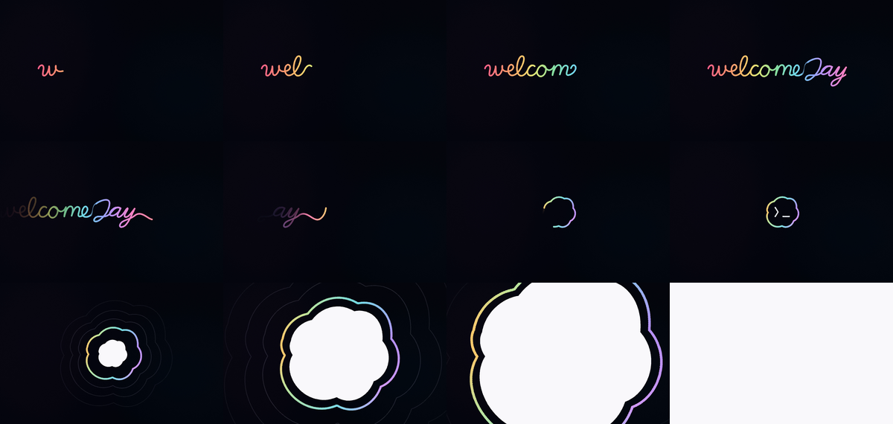

# Codex Splash

为 Windows 版 ChatGPT 制作的「Welcome Jay」开场动画。彩色细线写下连笔字，随后收成 Codex 图标。图标向外扩张，露出实际的 ChatGPT 窗口。



[观看 MP4 预览](Welcome%20Jay.mp4)

## 安装

1. 在 Windows 10 或 11 上安装并登录 Microsoft Store 版 ChatGPT。
2. 从 [GitHub Releases](https://github.com/li1-init/Codex-Splash/releases/latest) 下载 `Codex-Splash-Setup-*.exe`，双击后按向导完成安装。安装包使用当前用户目录，无需管理员权限。
3. 完全退出 ChatGPT，再双击桌面上的 **ChatGPT - Welcome Jay** 快捷方式。动画结束后会进入实际的 ChatGPT 窗口。

ChatGPT 已在运行时，快捷方式会直接唤起它。动画只通过这个桌面快捷方式触发。要卸载，在 Windows 的 **设置 → 应用 → 已安装的应用** 中卸载 **Codex Splash**，ChatGPT 仍可正常使用。

这是社区启动器，安装包未做代码签名。Release 附有 SHA-256 校验文件。

### 从源码创建快捷方式

克隆仓库或解压源码 ZIP，在项目目录打开 PowerShell，运行以下命令。此快捷方式直接使用当前项目目录，移动目录后需重新运行命令。

```powershell
powershell.exe -NoProfile -ExecutionPolicy Bypass -File .\Install-Shortcut.ps1
```

### 预览

用独立测试窗口预览转场，无需退出 ChatGPT。

```powershell
powershell.exe -NoProfile -Sta -ExecutionPolicy Bypass -File .\Launch.ps1 -Preview
```

## 二创与重新打包

可以直接换成自己的 MP4，也可以修改手写路径、颜色、时长或图标轮廓，再重新渲染并打包。[查看二创与重新打包指南](docs/REMIX.md)
